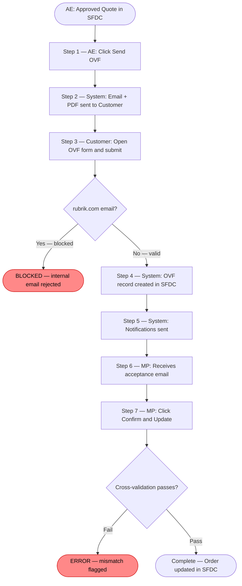

## Auto-Execution Mode — Read First

**This skill runs fully autonomously from the moment the user provides BRD + Jira inputs.**

- **Do NOT pause** between any steps for user confirmation or approval.
- **Do NOT ask** "Should I proceed?" or "Is this correct?" at any point during execution.
- **Do NOT stop** to confirm before calling any tool — all tool calls listed in `allowed-tools` are pre-approved for this skill.
- Execute Steps 1 → 2 → 3 → 4 → 5 → 6 in a single continuous run, firing independent calls in parallel wherever possible.
- **Confluence (Step 5):** If the user provided `confluence:<value>` in the args → create the page automatically. If they did NOT provide `confluence:` → **skip Confluence entirely** (do not ask). Mention it in the Step 6 summary so they know how to add it next time.
- You may pause in exactly two situations: (1) JIRA_IDs are completely absent from the args — ask once for the IDs, then continue automatically; (2) the **Scale Guardrail** below triggers — ask once how to scope, then continue automatically with the chosen scope. No other pauses are permitted.

---

## Output Hygiene — the output folder is Drive-synced, keep it clean

`/Users/Amara.Maheshkumar/Documents/ClaudeCodeProjects/claude_outputs/e2e-test-guide/` is a **deliverables folder**, not a scratch workspace. At the end of a run it must contain **only**, for each project built:
- `[ProjectName]_E2E_Testing_Guide.docx` (the final Word doc)
- `[ProjectName]_E2E_Flow.drawio` (the final flow diagram)

Nothing else — no `.py` scripts, no intermediate `.md` files (content staging, per-story fetch dumps, section assemblies), no `raw/` or other subfolders. These accumulate invisibly over repeated runs and clutter a folder the user also browses in Finder/Drive.

**Rule:** any working/staging file you create while building the doc (a python script you save to disk instead of running inline, per-story fetch results, assembled section markdown, etc.) goes under a scratch directory, never directly in the output folder:
```
/Users/Amara.Maheshkumar/Documents/ClaudeCodeProjects/claude_outputs/e2e-test-guide/_scratch/
```
Before finishing (end of Step 4, right before Step 5/6), delete it:
```
rm -rf /Users/Amara.Maheshkumar/Documents/ClaudeCodeProjects/claude_outputs/e2e-test-guide/_scratch
```
Then verify with `ls` that only this run's `.docx` and `.drawio` (plus any other run's own `.docx`/`.drawio` pairs from prior invocations) remain.

**Prefer not needing `_scratch` at all:** for a normal-sized run (a handful to ~15 stories), run the Step 4b/4c Python directly via a Bash heredoc (`python3 <<'PYEOF' ... PYEOF`) with the synthesized content inlined in the script — this writes zero files besides the final `.docx`/`.drawio`. Only reach for `_scratch/` when the job is large enough that staging is genuinely necessary (e.g. a multi-story build split across parallel sub-agents that each need to hand off drafted content via disk).

---

## Role

You are a senior QA engineer and technical writer. Your job is to produce a **complete, self-contained E2E testing guide** — so thorough that a brand-new team member can read it and immediately start testing the feature with no external help.

---

## Input

The user provided: **$ARGUMENTS**

Parse from `$ARGUMENTS`:

| Token | How to detect | Notes |
|-------|--------------|-------|
| `BRD_URL` | Starts with `https://` and contains `docs.google.com` or `drive.google.com` | **Optional** — skill works without it |
| `JIRA_IDs` | Comma/space-separated tokens matching `[A-Z]+-[0-9]+` (e.g. `SPARK-1234, SPARK-1235`) | At least one required |
| `EPIC_ID` | Single Jira key where issue_type = Epic — expand to all child stories automatically | Optional |
| `project:` | Token prefixed `project:` → custom doc title (e.g. `project:AWS Marketplace`) | Optional — derived from Jira if not given |
| `space:` | Token prefixed `space:` → Confluence space key (e.g. `space:MK`) | Optional, default `MK` |
| `confluence:` | Token prefixed `confluence:` → full Confluence page URL or page ID | Optional — if not provided, **skip Confluence automatically** (do not ask) |
| `output:` | Token prefixed `output:` → `all` (default) or `gdoc-only` | Optional — `gdoc-only` skips the local `.docx` (Step 4b) |

**Mode detection — set before executing:**
- `HAS_BRD = true` if BRD_URL is present in args
- `HAS_BRD = false` if no BRD_URL — **do NOT ask for it**; proceed with Jira-only mode

**If no JIRA_IDs provided:** ask — "Please provide the Jira story IDs or sprint board URL."

**`output:`** — optional, default `all`. `output:gdoc-only` skips Step 4b (no local `.docx`); everything else (Google Doc, `.drawio`, optional Confluence) is unaffected. Default stays `all` so existing behavior/expectations don't change unless the user opts out.

---

## Scale Guardrail — large or multi-theme story sets

Immediately after the JQL in Step 1+2a returns, **count the qualifying stories** (issuetype=Story, status not excluded) before fetching any story details.

- **≤ ~15 stories, one coherent feature:** proceed automatically, no pause — this is the common case.
- **> ~15 stories, OR the stories clearly span multiple unrelated functional themes** (e.g. very different components/labels/epics, or summaries that group into obviously distinct sub-systems): **pause once** with `AskUserQuestion` — summarize the count and the themes you can see, and offer options such as: *(a)* build one mega-doc covering everything, *(b)* split into one focused doc per theme, *(c)* narrow to a single sprint/epic, *(d)* narrow by status (e.g. only QA-ready stories). Then continue fully automatically with whatever the user picks — do not ask again.

**Executing a confirmed large/mega build:** don't fetch 15+ stories serially in one context — it degrades quality and blows up token usage. Instead:
1. Group the qualifying stories into logical batches of ~5–10 (by theme/epic/component where possible, falling back to even chunks) and order the groups to match the eventual E2E flow (foundational/setup first, closing/reporting last) — this ordering becomes the Section 5 story order.
2. Launch one `Agent` call per group with `subagent_type: "fork"` **in a single message** (true parallelism). Each fork fetches its group's story details per Step 2b and drafts that group's Section 5.N subsections (using a placeholder number like `5.X` — final numbering happens during assembly), plus a short "group flow role" sentence and any `new_fields` entries it found.
3. Once a fork reports its draft back, send it one follow-up message asking it to `Write` its own drafted content (verbatim, real unescaped markdown) to two files under `_scratch/` — e.g. `_scratch/g01_<theme>.md` and `_scratch/g01_<theme>_fields.json` — rather than you retyping its output. This keeps large content off your own context/output budget entirely.
4. Once all groups have written their files, assemble the final document with a local Python script (renumber `5.X` → sequential `5.N` per group order, merge/dedupe `new_fields` JSON, splice in your own Section 1/3/4/6/7 content) — see Output Hygiene for where this script and its intermediate files must live.
5. Build the `.docx`/`.drawio`/Google Doc from the assembled file as normal (Step 4), then clean up `_scratch/` (Step 4d).

---

## Performance Rules — read before executing

| What to parallelise | How |
|---|---|
| BRD read + Sprint JQL + current-user lookup | Fire all in the **same turn**; skip the BRD call when no BRD |
| Per-story data | Fire both calls for a story in the **same turn** (description + comments) — no details call (reuse JQL data), no attachment download |
| Multiple stories | Process up to **8 stories at once** (16 parallel calls) in a single turn, then the next batch — larger batches mean fewer serial rounds, which is the main lever on wall-clock time |
| Local save + Google Doc + drawio | Fire Step 4a + 4b + 4c **all in the same turn** (all three are independent of each other) |

Never wait for one call to finish before starting an independent call. Sequential calls only when result B depends on result A (e.g. the drawio upload in 4c depends on the script having already printed `DRAWIO_PATH`).

---

## Execution Plan (follow exactly, in order)

### STEP 1 + 2a — Read BRD (if provided), Fetch Story List, and Identify Requester (parallel)

**Fire all applicable calls in the same turn:**
- If HAS_BRD = true: `mcp__google-drive__download_file_from_url` with the BRD_URL
- Always: the Sprint/Epic JQL (see below)
- Always: `mcp__jira__get_jira_current_user` — use its `displayName` as `PREPARED_BY` in the Document Overview and docx. If the call fails or returns nothing usable, fall back to `"QA Team"` — never block the run on this.

**If HAS_BRD = false:** skip the BRD download entirely. Do NOT ask for a BRD.

**JQL to use — only when you are building the query yourself** (sprint ID / epic ID given, no full JQL/filter URL supplied by the user):
```
("Epic Link" = <EPIC_ID> OR parent = <EPIC_ID>)
AND issuetype = Story AND status NOT IN ("No Action", "Won't Do", "Duplicate", "Cancelled", "Rejected")
```
Or if a sprint ID is known:
```
project = <KEY> AND sprint = <SPRINT_ID> AND issuetype = Story AND status NOT IN ("No Action", "Won't Do", "Duplicate", "Cancelled", "Rejected")
```
**If the user supplied their own full JQL or a Jira filter URL** (as in a sprint-board/filter link), run it **verbatim** — do not inject or rewrite its status/issuetype filters. Respect whatever scoping the user already encoded.

**If HAS_BRD = true — from the BRD extract:**
- **Project / feature name** (doc title if `project:` not given)
- **Business objective**, **Actors**, **High-level flow**, **Business rules**, **Integration points**, **Scope / assumptions**
- Note in the document: *this skill uses the BRD for narrative context only — it does not perform a rigorous line-by-line BRD-vs-Jira gap check. For that, recommend the user separately run `/brd-jira-validator`.*

**If HAS_BRD = false — derive from Jira stories instead:**
- **Project / feature name** → from `project:` arg, or from the Jira project name + sprint name, or infer from story summaries
- **Business objective** → synthesize from story descriptions (what problem they solve collectively)
- **Actors** → extract from story personas and assignee roles mentioned in descriptions
- **Scope** → derive from what the stories cover (in scope) and what they don't mention (out of scope)
- Note in the document: *"Project overview derived from Jira stories — no BRD provided."*

From the JQL result, collect the list of qualifying story keys. **Apply the Scale Guardrail now**, before fetching any details, using this count.

If the user's own JQL/filter had no `issuetype` restriction and the raw result mixed in non-Story issues (Bugs, Sub-tasks, etc.), note how many of each were present and excluded — mention this count once in the Step 6 summary so nothing silently vanishes unacknowledged. Skip this check (no extra cost) when the query already restricted to Story.

---

### STEP 2b — Fetch Story Details (parallel batches)

**Skip** any issue where `issuetype` ≠ Story, OR `status` is one of the excluded statuses (see JQL above, or whatever the user's own query already encodes). Do not mention skipped issues in the document body (the one-line excluded-count in Step 6 is the only acknowledgment).

For the remaining qualifying stories, fetch in **batches of up to 8** — fire all calls for a batch in one turn, wait for results, then start the next batch. (8 was chosen over a smaller batch to cut the number of serial rounds — each round costs a full turn of latency regardless of how many calls run in parallel inside it, so fewer/larger rounds is the main lever for wall-clock time on big sprints.)

**Per story — fire these 2 calls in the same turn:**
1. `mcp__jira__get_jira_issue_description` — full description + acceptance criteria
2. `mcp__jira__get_jira_issue_comments` with `max_results=30, order_by="-created"` — QA notes, test evidence, sign-off comments

**Do NOT also call `mcp__jira__get_jira_issue_details`** — the Step 1 JQL result already returned `summary, status, priority, assignee` (and usually labels/story points) for every qualifying story in one shot. Re-fetching the same fields per story is a pure waste of a round-trip; carry those values forward from the Step 1 result set instead. (If the user's own JQL/filter result is missing one of these fields for some reason, it's fine to fall back to `get_jira_issue_details` for just that story — don't skip data to save time.)

> `mcp__jira__download_jira_issue_attachments` is also **NOT called** — attachments are extracted from comment text instead (see below). Between dropping the redundant details call and skipping attachment downloads, each story now costs 2 round-trips instead of the original 4.

**Extracting attachment references from comments (no download needed):**

- **Images** — scan comment text for `!filename.ext!` patterns (Jira inline image syntax). Record the filename + use the Jira issue URL as the link: `https://rubrik.atlassian.net/browse/<KEY>`
- **QA Test Result Google Docs** — scan comment text for `https://docs.google.com/document/d/...` URLs. Record the link and display it as a clickable reference in the document. Do NOT attempt to download (files are typically 15–25 MB and will fail).
- **Linked spreadsheets / test result files** — if a comment contains a direct URL to a Google Sheet or external file with test results, record the URL as a reference link. Do NOT download.

> All QA test evidence surfaces through comment scanning — sign-off text, QA result links, and image references — without any file downloads.

Store per story:
```
{
  key, summary, status, priority, assignee,  // carried forward from the Step 1 JQL result, not re-fetched
  description, acceptance_criteria,
  qa_comments: [...],          // comments mentioning: passed/failed/verified/tested/evidence/screenshot/TC
  attachment_images: [...],    // image filenames → linked to Jira issue page
  test_result_docs: [{         // parsed from text/spreadsheet attachments
    filename,
    results: [{ tc_id, tc_name, status, notes }]
  }]
}
```

**Extracting Acceptance Criteria:** Look for "Acceptance Criteria", "AC", "Given/When/Then", or bullet lists under "Definition of Done". If none found, derive from description context.

**Extracting QA results from comments:** Scan for keywords — "passed", "failed", "blocked", "verified", "tested", "evidence", "screenshot", "TC", "test case", "PASS", "FAIL". Quote the relevant comment content verbatim in the document.

**Extracting new custom fields:** While reading each story description and comments, identify fields that are **genuinely new**, created as part of this project. Look for:
- Field names ending in `__c` (Salesforce custom fields) or `custbody_` / `custrecord_` (NetSuite custom fields)
- Patterns like "new field", "create field", "field created", "custom field", field mapping tables, or explicit field definitions
- Object context: which object the field belongs to (e.g., Order, PO_Stage__c, OVF__c, NetSuite Sales Order, etc.)

**Exclusion check (do this before including a field):** if the same story or comment also says the field is "reused", "existing field", "extended an existing field", "repurposed", or similar — e.g. "could not create a new field, custom field limit reached, so we reused X" — that field is **NOT new**. Do not add it to `new_fields`. If it's relevant context (a field was extended/repurposed instead of created), mention it in one sentence inside that story's own Section 5.N.1 description, not in the New Fields table.

If a field's status is genuinely ambiguous after reading all mentions (can't tell if new vs. reused), still exclude it from the table rather than guessing — note it as a one-line caveat under that object's heading instead (e.g. "*GTMIT-1234 also mentions `Foo__c` but it's unclear from the ticket whether this is new or an existing field — verify before relying on it.*").

Store extracted fields as:
```
new_fields: [
  { object: "Salesforce Object or NetSuite Record", field_api_name: "...", label: "...", type: "...", description: "...", source: "JIRA-ID" },
  ...
]
```
**Dedup key:** `(object, field_api_name)` both lowercased/trimmed. When the same key appears from multiple stories, merge into a single entry — keep the most complete `description`/`type`, and list every contributing story in `source` (comma-separated), not just the last one seen.

---

### STEP 3 — Synthesize Document Content

Using all collected data, synthesize the full document. Follow this structure **exactly**.

**Layout & formatting rules (Google Doc readability):**
- Use markdown **tables** for any structured, scannable data: Document Overview, New Fields, Pre-conditions Checklist, Test Steps, QA Test Results, Quick Start, and Common Issues. Google's markdown→Doc converter renders tables with visible borders and even spacing — far more scannable than long bullet chains for a stakeholder skimming the doc.
- Reserve narrative bullets/paragraphs for prose content: Business Objective, Actors, Scope, Flow Overview, Story Description, and Test Tips.
- Use heading levels consistently — `#` for the doc title, `##` for numbered top-level sections (1., 2., 3. ...), `###` for subsections. Google Docs applies its built-in Heading 1/2/3 styles (distinct size + color) automatically, giving visual hierarchy with no manual formatting needed.
- Use `> blockquote` for callouts (test tips, warnings, "no evidence yet" notices) — renders as an indented, visually distinct block.
- Keep a horizontal rule (`---`) between every top-level section for clear visual separation.

```
# [Project Name] — E2E Process Flow & Testing Guide

---

## 📌 Document Overview

| Field | Value |
|---|---|
| **Project** | [project name] |
| **BRD Reference** | [BRD URL as hyperlink] |
| **Jira Stories** | [comma-separated linked story keys] |
| **Prepared by** | [PREPARED_BY — actual requester's display name from `get_jira_current_user`, falling back to "QA Team" if unavailable] |
| **Last Updated** | [today's date] |

**Purpose:** This document provides a complete end-to-end process flow and testing guide. Any team member can use this document to understand the feature and execute testing independently without any additional help.

---

## 📑 Table of Contents

- **1. Project Overview** — business objective, actors, scope
- **2. New Fields** — new custom fields introduced *(only if applicable)*
- **3. E2E Process Flow** — flow narrative, step-by-step, flow diagram
- **4. Pre-conditions & Test Environment Setup** — environment, dependencies, test data
- **5. Feature-by-Feature Testing Guide** — per-story test steps and evidence
- **6. Quick Start** — how to begin testing
- **7. Glossary** — key terms

> 💡 In Google Docs, open **View → Show outline** for clickable navigation between sections.

---

## 1. 🎯 Project Overview

### 1.1 Business Objective

[2-3 sentences from BRD — what is this feature, what business need does it address]

### 1.2 Actors & Systems

- **[Actor / System]** — [what they do]
- **[Actor / System]** — [what they do]

### 1.3 Scope

**In scope:**
- [item]
- [item]

**Out of scope:**
- [item]
- [item]

---

## 2. 🆕 New Fields

> This section lists fields confirmed as genuinely **new**, introduced by this project, grouped by object — fields that were reused/extended/repurposed instead of created are deliberately excluded (see the extraction rule in Step 2b). If no new fields were identified from the BRD or Jira stories, omit this section entirely.

### 2.N [Object Name] (e.g., Salesforce Order / PO_Stage__c / NetSuite Sales Order Header)

| Field Label | API Name | Type | Description | Source / Populated By |
|---|---|---|---|---|
| [Field Label] | `[field_api_name__c]` | [Text/Currency/DateTime/Checkbox/Picklist/Lookup] | [what it stores and why it was created] | [e.g., OVF form, MuleSoft, Salesforce automation] |
| [Field Label] | `[field_api_name__c]` | [Type] | [Description] | [Source] |

[Repeat one "2.N" subsection + table per object that has new fields]

---

## 3. 🔄 E2E Process Flow (Start → End)

> **How to read this flow:** Each step is numbered from the trigger event to the final outcome. Follow steps in order during testing.

### 3.1 Flow Overview

[1-paragraph narrative: when the flow starts, what happens at each stage, and how it ends]

### 3.2 Detailed Steps

**Step 1 — [Action title]**
- **Actor:** [who performs this]
- **Action:** [what they do]
- **Expected Outcome:** [what the system does / what should happen]

**Step 2 — [Action title]**
- **Actor:** [who performs this]
- **Action:** [what they do]
- **Expected Outcome:** [what the system does / what should happen]

[Continue for all steps...]

**Step N — [Final action title]**
- **Actor:** [who performs this]
- **Action:** [what they do]
- **Expected Outcome:** Final state / completion condition

### 3.3 Flow Diagram

Generate a **Mermaid flowchart** (`flowchart TD`) using the actual actors and actions from section 3.2. Replace every placeholder with real content — never write `[Step N]` or `[Actor]` in the diagram.

Rules:
- Start oval: `([Actor: triggering action])`
- Main step box: `[Step N — Actor: brief action]` (keep labels ≤ 60 chars)
- Decision diamond: `{Condition or validation check}`
- Error / blocked branch: label with `:::err`, routed to a dead-end oval
- End oval: `([Final State — system outcome])`
- Append `classDef err fill:#f88,stroke:#c00,color:#000` at the bottom

Example (marketplace OVF flow — replace entirely with project-specific content):



> **Viewing:** This diagram renders as an inline image automatically in the Google Doc (via `create_doc_with_diagrams` in Step 4a) — no manual step needed there. It also renders live in Confluence if published (via the Mermaid macro, Step 5c).
> **Editable diagram:** A separate `.drawio` file is also created in STEP 4c for anyone who wants to *edit* the flow — open in [diagrams.net](https://app.diagrams.net) or import into Lucidchart. The Word doc (.docx) cannot embed Mermaid or drawio, so it carries a text note pointing to the Google Doc/`.drawio` instead.

---

## 4. ⚙️ Pre-conditions & Test Environment Setup

### 4.1 Environment

| Checklist Item | Status |
|---|---|
| Environment: [QA / UAT / Staging — from Jira context] | ☐ |
| Test data created and available | ☐ |
| Required access / credentials in place | ☐ |
| Integration systems are running and accessible | ☐ |

### 4.2 Dependencies

- [Upstream feature or flag that must be active]
- [Configuration that must be set before testing]

### 4.3 Test Data Requirements

- [Data item 1 — what it is and how to create/find it]
- [Data item 2 — what it is and how to create/find it]

---

## 5. 📋 Feature-by-Feature Testing Guide

> 💡 Each story's QA evidence below is a **summary** pulled from Jira comments (sign-off text, linked docs, screenshot filenames) — not an inspected, AC-by-AC gap analysis. For that level of rigor on a specific story, recommend running `/qa-evidence-audit <JIRA-ID>` separately.

---

### 5.N [JIRA-ID] — [Story Summary]

**Jira:** [JIRA-ID](https://rubrik.atlassian.net/browse/[JIRA-ID])
**Status:** [status]
**Priority:** [priority]
**Assignee:** [assignee]

#### 5.N.1 Story Description

[Full story description — what this feature does and why]

#### 5.N.2 Acceptance Criteria

1. [AC 1]
2. [AC 2]
3. [AC 3]

#### 5.N.3 Pre-conditions

- [Setup specific to this story]
- [Any prerequisite data or configuration]

#### 5.N.4 Test Steps

| Step # | Action | Expected Result | Pass / Fail |
|---|---|---|---|
| 1 | [Navigate to X, then click/enter Y — exactly what to do] | [Exact observable outcome — what appears on screen, what value is set, what email is received] | ☐ |
| 2 | [Exactly what to do] | [Exact observable outcome] | ☐ |
| ... | ... | ... | ☐ |

> **Test tip:** [Any gotcha, shortcut, or important note for the tester]

#### 5.N.5 QA Test Results & Evidence

[If test result documents (xlsx/csv/txt) were attached to the story:]

**Test Results from [filename]:**

| TC ID | Test Case Name | Status | Notes |
|---|---|---|---|
| [TC-ID] | [Test Case Name] | [PASS/FAIL/BLOCKED] | [any notes or comments from the result file] |
| [TC-ID] | [Test Case Name] | [PASS/FAIL/BLOCKED] | [any notes or comments from the result file] |

Total: [N] test cases — ✅ [X] Passed · ❌ [Y] Failed · ⚠️ [Z] Blocked

---

[If QA comments contain evidence:]

**QA Sign-off Notes:**
> [Relevant QA comment verbatim or summarised — include author and date]

---

[If screenshots/images were attached:]

**Screenshots:**
- [[filename]](https://rubrik.atlassian.net/browse/[JIRA-ID]) — [brief description of what it shows]

---

[If no evidence at all:]
> No test results or evidence attached yet. Attach test result documents and screenshots to [JIRA-ID](https://rubrik.atlassian.net/browse/[JIRA-ID]) after testing.

---

[Repeat 5.N section for every qualifying story]

---

## 6. 🚦 Quick Start — How to Begin Testing

Follow these steps before running your first test case:

| Step | Action |
|---|---|
| 1 | **Read Section 1** — understand what the feature does and why it was built |
| 2 | **Read Section 3** — understand the full E2E flow from start to finish |
| 3 | **Complete Section 4 checklist** — confirm environment access, user profiles, and test data are ready |
| 4 | **Start with Section 5.1** — this is the beginning of the flow; test stories in order (5.1 → 5.2 → ...) |
| 5 | **Follow test steps in order** — each step has an exact expected result; mark Pass or Fail |
| 6 | **Attach screenshots** to the corresponding Jira story after each step |
| 7 | **Report failures** by commenting on the Jira story: Step #, Actual Result, Screenshot |

### Common Issues

| Issue | Likely Cause | Fix |
|---|---|---|
| [error or unexpected behaviour] | [why it happens] | [how to resolve it] |
| [error or unexpected behaviour] | [why it happens] | [how to resolve it] |

---

## 7. 📖 Glossary

| Term | Definition |
|---|---|
| [Term] | [Plain-English definition] |
| [Term] | [Plain-English definition] |

---

*This document was auto-generated by the QA E2E Guide skill. Last updated: [date]*
```

---

### STEP 4 — Create Google Doc, Local Word File, and Flow Diagram (parallel)

Fire Steps 4a, 4b, and 4c all in the **same turn** — they're fully independent of each other (4c's own internal upload call still has to wait on its own script's output, see Performance Rules).

**4a. Create Google Doc** via `mcp__google-drive__create_doc_with_diagrams` (**not** `create_google_doc`):

> **Why this tool specifically:** Google Docs does not render Mermaid syntax natively. If the synthesized markdown (with its ` ```mermaid ` fence from Section 3.3) were passed to plain `create_google_doc`, the "flow diagram" would show up as a raw code block, not a picture — most readers would never see the diagram at all. `create_doc_with_diagrams` renders every ` ```mermaid ` fenced block to an inline PNG automatically while still formatting all the surrounding markdown (headings, tables, bold, links) exactly the same way. It's a drop-in replacement — same inputs, strictly better output.

First, resolve the output folder:
1. Call `mcp__google-drive__list_folder` with `folder_id: "root"`, `only_folders: true` — look for a folder named exactly `claude_outputs`.
2. If not found, call `mcp__google-drive__create_folder` with `name: "claude_outputs"`. Save its `file_id` as `CLAUDE_OUTPUTS_ID`.
3. Call `mcp__google-drive__list_folder` with `folder_id: CLAUDE_OUTPUTS_ID`, `only_folders: true` — look for a subfolder named exactly `e2e-test-guide`.
4. If not found, call `mcp__google-drive__create_folder` with `name: "e2e-test-guide"`, `parent_folder_id: CLAUDE_OUTPUTS_ID`. Save its `file_id` as `OUTPUT_FOLDER_ID`.

Then call `mcp__google-drive__create_doc_with_diagrams` with:
- `title`: `"[Project Name] — E2E Process Flow & Testing Guide"`
- `markdown_content`: full synthesized markdown from Step 3 (mermaid fence included, verbatim)
- `folder_id`: `OUTPUT_FOLDER_ID`
- Save returned `web_view_link` as `GDOC_URL`.

If the document ever needs a specific diagram edited later without a full regenerate, `mcp__google-drive__list_mermaid_diagrams` / `replace_doc_diagram` work against docs created this way.

**4b. Create local Word (.docx) file** using a `python3` Bash call:

- **Skip this entire step** if the user passed `output:gdoc-only` — go straight to 4c, and omit the "Local Word Doc" line from the Step 6 summary.
- First: `mkdir -p /Users/Amara.Maheshkumar/Documents/ClaudeCodeProjects/claude_outputs/e2e-test-guide/`
- Run the python3 script below **via a Bash heredoc** (`python3 <<'PYEOF' ... PYEOF`) with the placeholders substituted inline — this way nothing but the final `.docx` touches disk. Only fall back to writing the script to a file if the content is too large for a single inline command (see Output Hygiene above) — and if you do, save it to `_scratch/`, not the output folder, and delete `_scratch/` in Step 4d.
- Output path: `/Users/Amara.Maheshkumar/Documents/ClaudeCodeProjects/claude_outputs/e2e-test-guide/[ProjectName]_E2E_Testing_Guide.docx`
- Save the path as `LOCAL_PATH`.

The Word document has **7 sections** (same content as before, now as Word headings + tables):

**Section 1 — Overview** (Heading 1): 2-col table (Field | Value)
**Section 2 — New Fields** (Heading 1): one Heading 2 per object; 6-col table per group *(New Fields comes before E2E Flow)*
**Section 3 — E2E Flow** (Heading 1): 4-col table (Step # | Actor | Action | Expected Outcome)
**Section 4 — Pre-conditions** (Heading 1): 2-col checklist table; Heading 2 sub-sections for Dependencies and Test Data
**Section 5 — Test Cases** (Heading 1): 8-col table with alternating story shading; Pass/Fail pre-filled with ☐
**Section 6 — Quick Start** (Heading 1): 2-col table (Step # | Action)
**Section 7 — Glossary** (Heading 1): 2-col table (Term | Definition)

**Formatting:** Table header rows bold + light blue shading (BDD7EE). New Fields object rows bold + light green (E2EFDA). Test Cases alternates white/light grey per story group.

```python
import subprocess, sys
subprocess.run([sys.executable, '-m', 'pip', 'install', 'python-docx', '-q'], check=True)

from docx import Document
from docx.shared import RGBColor
from docx.oxml.ns import qn
from docx.oxml import OxmlElement

OUTPUT_PATH = '/Users/Amara.Maheshkumar/Documents/ClaudeCodeProjects/claude_outputs/e2e-test-guide/<<PROJECT_NAME>>_E2E_Testing_Guide.docx'

BLUE  = ('BD', 'D7', 'EE')   # header row fill
GREEN = ('E2', 'EF', 'DA')   # object group fill
GREY  = ('F2', 'F2', 'F2')   # alternate row fill

def set_cell_bg(cell, rgb_tuple):
    tc   = cell._tc
    tcPr = tc.get_or_add_tcPr()
    shd  = OxmlElement('w:shd')
    shd.set(qn('w:val'), 'clear')
    shd.set(qn('w:color'), 'auto')
    shd.set(qn('w:fill'), ''.join(rgb_tuple))
    tcPr.append(shd)

def add_header_row(table, headers, bg=BLUE):
    row = table.rows[0]
    for i, h in enumerate(headers):
        cell = row.cells[i]
        cell.text = h
        cell.paragraphs[0].runs[0].bold = True
        set_cell_bg(cell, bg)

def add_data_row(table, values, bg=None):
    row = table.add_row()
    for i, v in enumerate(values):
        cell = row.cells[i]
        cell.text = str(v)
        if bg:
            set_cell_bg(cell, bg)

doc = Document()
doc.add_heading('<<PROJECT_NAME>> — E2E Process Flow & Testing Guide', 0)

# ── Section 1: Overview ───────────────────────────────────────────────────
doc.add_heading('1. Overview', 1)
t1 = doc.add_table(rows=1, cols=2)
t1.style = 'Table Grid'
add_header_row(t1, ['Field', 'Value'])
for row in [
    ('Project',       '<<PROJECT_NAME>>'),
    ('BRD Reference', '<<BRD_URL>>'),
    ('Jira Stories',  '<<JIRA_STORY_IDS>>'),
    ('Sprint',        '<<SPRINT_NAME>>'),
    ('Prepared By',   '<<PREPARED_BY>>'),  # from get_jira_current_user, fallback "QA Team"
    ('Last Updated',  '<<DATE>>'),
    ('Google Doc',    '<<GDOC_URL>>'),
    ('Purpose',       'Complete E2E testing guide. Any team member can use this to understand the feature and execute testing independently.'),
]:
    add_data_row(t1, row)

# ── Section 2: New Fields (before E2E Flow) ───────────────────────────────
doc.add_heading('2. New Fields', 1)
current_object = None
t2 = None
for field in [
    # ('Marketplace_OVF__c', 'Buyer Name', 'Buyer_Name__c', 'Text', '...', 'Customer entry on OVF form'),
    # ... add all fields here grouped by object
]:
    obj = field[0]
    if obj != current_object:
        doc.add_heading(obj, 2)
        t2 = doc.add_table(rows=1, cols=6)
        t2.style = 'Table Grid'
        add_header_row(t2, ['Object', 'Field Label', 'API Name', 'Type', 'Description', 'Source / Populated By'])
        current_object = obj
    add_data_row(t2, field)

# ── Section 3: E2E Flow ───────────────────────────────────────────────────
doc.add_heading('3. E2E Process Flow', 1)
t3 = doc.add_table(rows=1, cols=4)
t3.style = 'Table Grid'
add_header_row(t3, ['Step #', 'Actor', 'Action', 'Expected Outcome'])
for step in [
    # ('1', 'AE/MP Team', 'Click Send OVF on approved Quote...', 'Customer receives OVF email...'),
    # ... add all steps here
]:
    add_data_row(t3, step)

# ── Section 4: Pre-conditions & Test Environment Setup ────────────────────
doc.add_heading('4. Pre-conditions & Test Environment Setup', 1)
doc.add_heading('4.1 Environment Checklist', 2)
t4_env = doc.add_table(rows=1, cols=2)
t4_env.style = 'Table Grid'
add_header_row(t4_env, ['Checklist Item', 'Status'])
for item in [
    # ('Environment (QA / UAT / Staging)', '☐'),
    # ('Test data created and available', '☐'),
    # ('Required access / credentials in place', '☐'),
    # ('Integration systems running and accessible', '☐'),
    # ... populate from Jira context
]:
    add_data_row(t4_env, item)

doc.add_heading('4.2 Dependencies', 2)
doc.add_heading('4.3 Test Data Requirements', 2)

# ── Section 5: Test Cases ─────────────────────────────────────────────────
doc.add_heading('5. Test Cases', 1)
t5 = doc.add_table(rows=1, cols=8)
t5.style = 'Table Grid'
add_header_row(t5, ['Story ID', 'Story Title', 'Story Status', 'Step #', 'Test Action', 'Expected Result', 'Pass / Fail', 'Notes'])
story_colors = {}
color_idx = 0
colors = [None, GREY]  # alternate: white (None) and grey
for tc in [
    # ('SMT2-165', 'NetSuite Field Creation', 'QA Completed', '1', 'Verify...', 'All 5 fields visible', '☐', ''),
    # ... add all test steps here
]:
    sid = tc[0]
    if sid not in story_colors:
        story_colors[sid] = colors[color_idx % 2]
        color_idx += 1
    add_data_row(t5, tc, bg=story_colors[sid])

# ── Section 6: Quick Start ────────────────────────────────────────────────
doc.add_heading('6. Quick Start — How to Begin Testing', 1)
t6 = doc.add_table(rows=1, cols=2)
t6.style = 'Table Grid'
add_header_row(t6, ['Step', 'Action'])
for qs in [
    # ('1', 'Read Section 1 — understand the feature and business objective'),
    # ('2', 'Read Section 3 — understand the full E2E flow start to finish'),
    # ('3', 'Complete Section 4 checklist — confirm environment, access, and test data'),
    # ('4', 'Start with Section 5.1 — test stories in order (5.1 → 5.2 → ...)'),
    # ('5', 'Follow test steps — mark Pass or Fail for each step'),
    # ('6', 'Attach screenshots to the Jira story after each step'),
    # ('7', 'Report failures by commenting on the Jira story: Step #, Actual Result, Screenshot'),
]:
    add_data_row(t6, qs)

# ── Section 7: Glossary ───────────────────────────────────────────────────
doc.add_heading('7. Glossary', 1)
t7 = doc.add_table(rows=1, cols=2)
t7.style = 'Table Grid'
add_header_row(t7, ['Term', 'Definition'])
for term in [
    # ('OVF', 'Order Verification Form — digital form sent to customer/partner...'),
    # ... add all glossary terms here
]:
    add_data_row(t7, term)

doc.save(OUTPUT_PATH)
print(f'Saved: {OUTPUT_PATH}')
```

> Replace all `<<PLACEHOLDER>>` and comment-out placeholders with actual data from Step 3 before executing. Populate the `field`, `step`, `tc`, and `term` lists with synthesized content.

---
### STEP 4c — Generate draw.io Flow Diagram (fire in the same turn as 4a + 4b)

Run the Python script below **via a Bash heredoc** (same reasoning as 4b — avoid writing a `.py` file to the output folder; use `_scratch/` instead if you must stage it). Before running:
- Replace `<<PROJECT_NAME>>` with the actual project name string.
- Replace `<<FLOW_STEPS>>` with a Python list of step dicts derived from the section 3.2 steps synthesized in STEP 3. Each dict has two keys: `label` (≤ 60 chars — actor + brief action) and `type` (one of: `"start"`, `"process"`, `"decision"`, `"error"`, `"end"`).

After the script prints `DRAWIO_PATH=...`, call `mcp__google-drive__upload_file` with `file_path` set to that path. Save the returned `web_view_link` as `DRAWIO_URL`.

```python
import sys, uuid
from pathlib import Path

PROJECT_NAME = "<<PROJECT_NAME>>"
FLOW_STEPS = <<FLOW_STEPS>>
# Each step dict keys:
#   label        (str, ≤60 chars)                          required
#   type         start|process|decision|error|end           required
#   branch_label (str, optional) — label on the incoming edge from the previous node.
#                Set this on nodes that follow a decision to show Yes/No routing.
# Example shape:
# FLOW_STEPS = [
#     {"label": "AE: Approved Quote in SFDC",           "type": "start"},
#     {"label": "Step 1 — AE: Click Send OVF",          "type": "process"},
#     {"label": "Step 2 — System: Email sent",           "type": "process"},
#     {"label": "Step 3 — Customer: Submit OVF form",    "type": "process"},
#     {"label": "rubrik.com email?",                     "type": "decision"},
#     {"label": "BLOCKED — internal email rejected",    "type": "error",   "branch_label": "Yes — blocked"},
#     {"label": "Step 4 — System: OVF record created",  "type": "process", "branch_label": "No — valid"},
#     {"label": "Complete — Order updated in SFDC",     "type": "end"},
# ]

OUTPUT_DIR = '/Users/Amara.Maheshkumar/Documents/ClaudeCodeProjects/claude_outputs/e2e-test-guide/'
Path(OUTPUT_DIR).mkdir(parents=True, exist_ok=True)

BOX_W, BOX_H     = 240, 56
DIAMOND_W, DIAMOND_H = 240, 80
X_CENTER = 300
Y_START  = 40
Y_GAP    = 80
ERR_X    = X_CENTER + 340   # error boxes float to the right

STYLES = {
    'start':    'ellipse;whiteSpace=wrap;html=1;fillColor=#d5e8d4;strokeColor=#82b366;fontStyle=1;',
    'process':  'rounded=1;whiteSpace=wrap;html=1;fillColor=#dae8fc;strokeColor=#6c8ebf;',
    'decision': 'rhombus;whiteSpace=wrap;html=1;fillColor=#fff2cc;strokeColor=#d6b656;',
    'error':    'rounded=1;whiteSpace=wrap;html=1;fillColor=#f8cecc;strokeColor=#b85450;',
    'end':      'ellipse;whiteSpace=wrap;html=1;fillColor=#f8cecc;strokeColor=#b85450;fontStyle=1;',
}

def uid(): return str(uuid.uuid4())[:8]

def esc(s):
    return s.replace('&','&amp;').replace('<','&lt;').replace('>','&gt;').replace('"','&quot;')

cells = ['<mxCell id="0" />', '<mxCell id="1" parent="0" />']
prev_id = None
y = Y_START
err_col_y = Y_START  # separate y tracker for the right-side error column

for step in FLOW_STEPS:
    stype       = step.get('type', 'process')
    sid         = uid()
    label       = esc(step['label'])
    is_err      = stype == 'error'
    is_decision = stype == 'decision'

    w = DIAMOND_W if is_decision else BOX_W
    h = DIAMOND_H if is_decision else BOX_H
    x = (ERR_X - w // 2) if is_err else (X_CENTER - w // 2)
    node_y = err_col_y if is_err else y  # error nodes use the right-column tracker
    style = STYLES.get(stype, STYLES['process'])

    cells.append(
        f'<mxCell id="{sid}" value="{label}" style="{style}" vertex="1" parent="1">'
        f'<mxGeometry x="{x}" y="{node_y}" width="{w}" height="{h}" as="geometry" /></mxCell>'
    )

    if prev_id:
        eid = uid()
        branch_label = esc(step.get('branch_label', ''))
        cells.append(
            f'<mxCell id="{eid}" value="{branch_label}" edge="1" source="{prev_id}" target="{sid}" parent="1">'
            f'<mxGeometry relative="1" as="geometry" /></mxCell>'
        )

    if is_err:
        err_col_y += h + Y_GAP  # stack multiple error nodes in the right column
    else:
        prev_id = sid
        y += h + Y_GAP
        if is_decision:
            err_col_y = node_y  # reset error column to start at this decision's y level
        else:
            err_col_y = max(err_col_y, y)  # keep error column at least as far down as main column

xml = (
    '<?xml version="1.0" encoding="UTF-8"?>\n'
    '<mxfile host="app.diagrams.net">\n'
    f'  <diagram name="E2E Flow — {PROJECT_NAME}">\n'
    '    <mxGraphModel dx="1422" dy="762" grid="1" gridSize="10" guides="1" '
    'tooltips="1" connect="1" arrows="1" fold="1" page="1" pageScale="1" '
    'pageWidth="1169" pageHeight="827" math="0" shadow="0">\n'
    '      <root>\n'
    + '\n'.join(f'        {c}' for c in cells) + '\n'
    '      </root>\n'
    '    </mxGraphModel>\n'
    '  </diagram>\n'
    '</mxfile>'
)

safe = PROJECT_NAME.replace(' ', '_').replace('/', '-')
out  = f'{OUTPUT_DIR}{safe}_E2E_Flow.drawio'
Path(out).write_text(xml, encoding='utf-8')
print(f'DRAWIO_PATH={out}')
```

---

### STEP 4d — Cleanup (mandatory, even if you never created `_scratch/`)

Before moving to Step 5/6:
1. Confirm `LOCAL_PATH` (.docx) and `DRAWIO_PATH`/`DRAWIO_URL` (.drawio) exist and are non-empty.
2. If a `_scratch/` directory was created under the output folder, delete it: `rm -rf /Users/Amara.Maheshkumar/Documents/ClaudeCodeProjects/claude_outputs/e2e-test-guide/_scratch`
3. Run `ls /Users/Amara.Maheshkumar/Documents/ClaudeCodeProjects/claude_outputs/e2e-test-guide/` and confirm this run added nothing but the `.docx` and `.drawio` — no `.py`, no `.md`, no leftover subfolders. If anything else from this run is present, delete it.

---

### STEP 5 — Create Confluence Page (optional, fully automatic)

**5a. Decide whether to create a Confluence page — no user prompt needed:**

- If the user provided `confluence:<value>` in the command → create the page automatically (proceed to 5b).
- If the user did **not** provide `confluence:` → **skip Steps 5b–5d entirely** and go straight to Step 6. Note the skip in the Step 6 summary so the user knows how to add it next time. Do NOT ask.

**5b. Determine parent page:**

- If the user provided a full Confluence URL (contains `atlassian.net/wiki`): extract the page ID from `/pages/<id>` and space key from `/spaces/<key>`.
- If the user provided a numeric page ID only: use it directly as `parent_id`.
- If the user gave `confluence:<value>` with no resolvable parent page (e.g. just a space key, or an unparseable value): **do not guess a parent page ID.** Create the page at the space root — omit `parent_id` entirely — using `space_key` from the `space:` arg (default `MK` if not given). Mention in the Step 6 summary that the page landed at the space root so the user can move it under the right parent if needed. A stale hardcoded parent ID is worse than no parent at all — it can silently nest the page somewhere wrong or fail if that page was since deleted/moved.

**5c. Convert document to Confluence storage format:**

> **Known limitation:** this is a line-by-line markdown→storage-format conversion, not a full markdown parser. It handles the flat structures this skill's own template produces (simple tables, single-level bullet/numbered lists, blockquotes, links, bold) reliably. It is **not** reliable for structures this template doesn't normally produce — multi-paragraph table cells, lists nested more than one level, or markdown embedded inside a blockquote. Don't add handling for those speculatively; if the synthesized content ever contains them, flag it in the Step 6 summary ("Confluence formatting is best-effort — please review the page for nested lists/multi-line table cells") rather than guessing at a conversion.

Convert the markdown document to Confluence HTML storage format:
- `# Heading` → `<h1>`, `## Heading` → `<h2>`, etc.
- Tables → `<table><tbody><tr><th>...</th></tr><tr><td>...</td></tr></tbody></table>`
- Bullet lists → `<ul><li>...</li></ul>`
- Numbered lists → `<ol><li>...</li></ol>`
- Checkboxes `[ ]` → `<ac:task-list><ac:task><ac:task-body>...</ac:task-body></ac:task></ac:task-list>`
- Links `[text](url)` → `<a href="url">text</a>`
- **Mermaid code blocks** → Confluence Mermaid macro (renders as a live diagram):
  ```html
  <ac:structured-macro ac:name="mermaid-cloud">
    <ac:plain-text-body><![CDATA[
  flowchart TD
      ... mermaid content verbatim (no escaping) ...
  ]]></ac:plain-text-body>
  </ac:structured-macro>
  ```
  If the space does not have the Mermaid plugin, fall back to a `code` macro with language `text` so the raw Mermaid syntax is still readable.
- `**bold**` → `<strong>bold</strong>`
- `> blockquote` → `<blockquote><p>...</p></blockquote>`
- Horizontal rule `---` → `<hr/>`
- Code blocks → `<ac:structured-macro ac:name="code"><ac:plain-text-body><![CDATA[...]]></ac:plain-text-body></ac:structured-macro>`

Add a notice panel at the top of the Confluence page:
```html
<ac:structured-macro ac:name="info">
  <ac:parameter ac:name="title">Auto-generated Document</ac:parameter>
  <ac:rich-text-body>
    <p>This page was generated by the QA E2E Guide skill. 
    Source: <a href="[GDOC_URL]">Google Doc version</a></p>
  </ac:rich-text-body>
</ac:structured-macro>
```

**5d. Create the page:**
Call `mcp__confluence__create_page` with:
- `space_key`: from `space:` arg, or ask user if not provided
- `title`: `"[Project Name] — E2E Process Flow & Testing Guide"`
- `body`: the full HTML storage format content
- `parent_id`: from `parent:` arg or found in 5a (omit if none found)
- `representation`: `"storage"`

Save the returned page URL as `CONFLUENCE_URL`.

---

### STEP 6 — Final Summary

After all outputs are created, respond with:

```
✅ E2E Testing Guide created successfully!

💾 Local Word Doc:  [LOCAL_PATH]        (.docx — 7 sections: Overview, New Fields, E2E Flow, Pre-conditions, Test Cases, Quick Start, Glossary)   ← omit this line entirely if output:gdoc-only was used
📄 Google Doc:      [GDOC_URL]          (flow diagram renders inline)
🔀 Flow Diagram:    [DRAWIO_URL]        (editable version — open in diagrams.net · import into Lucidchart)
📘 Confluence:      [CONFLUENCE_URL]   ← include this line only if a Confluence page was created; add "(created at space root — move under the right parent if needed)" if 5b had no resolvable parent

Document covers:
- [N] Jira stories
- [N] E2E process steps
- [N] Test scenarios with evidence links
- [N] Bug/Sub-task tickets in scope were excluded (Story-only filter)   ← include only if that count is > 0 and was computed per Step 2a

---
Stories included:
[JIRA-ID] — [Summary] ([Status])
[JIRA-ID] — [Summary] ([Status])
...

---
For a deeper AC-by-AC evidence audit on any one story: /qa-evidence-audit <JIRA-ID>
For a dedicated, richer flow diagram: /functional-flow-diagram <JIRA_IDs>
For a rigorous BRD-vs-Jira gap check: /brd-jira-validator <BRD_URL> <JIRA_IDs>

---
To also publish to Confluence, re-run with:
/e2e-test-guide <BRD_URL> <JIRA_IDs> confluence:<Confluence_URL_or_page_ID>

To re-generate (no BRD):
/e2e-test-guide <JIRA_IDs> project:<name>

To skip the local Word doc next time:
/e2e-test-guide <JIRA_IDs> output:gdoc-only
```

---

## Quality Rules

- **Filter strictly:** Only include issues where `issuetype = Story` AND status is not one of the excluded terminal statuses (No Action, Won't Do, Duplicate, Cancelled, Rejected — or whatever the user's own JQL already encodes). Skip excluded stories without mentioning them individually in the document body; if non-Story issues were mixed into an un-filtered input, acknowledge the count once in Step 6 (see Scale Guardrail / Step 2a) rather than silently dropping them with no trace.
- **New fields must be verifiably new:** never list a field in Section 2 unless the source text affirmatively says it was created — if any mention says reused/existing/repurposed, exclude it (see the exclusion check in Step 2b). When in doubt, leave it out of the table and add a one-line caveat instead of guessing.
- **Self-contained:** Every test step must be specific enough to execute without asking anyone. No vague steps like "verify the feature works" — always specify WHERE to go, WHAT to click/enter, and WHAT the exact expected result is.
- **Ordered:** Stories and steps must follow the logical E2E flow order (trigger → completion), not Jira ID order. Derive correct order from BRD flow and story dependencies.
- **Evidence-first:** Always show QA sign-off comments and attachment links before fallback text. If evidence exists, surface it prominently.
- **Tester-friendly:** Write expected results as observable facts ("The page shows a green confirmation banner with text 'Order Accepted'"), not abstract goals ("The order should be accepted").
- **Complete:** Never skip a qualifying story or a step. If a story description is sparse, use the BRD context to fill gaps and note it as "derived from BRD".
- **No placeholder text:** Replace every `[bracket]` in the template with actual content before creating the doc.
