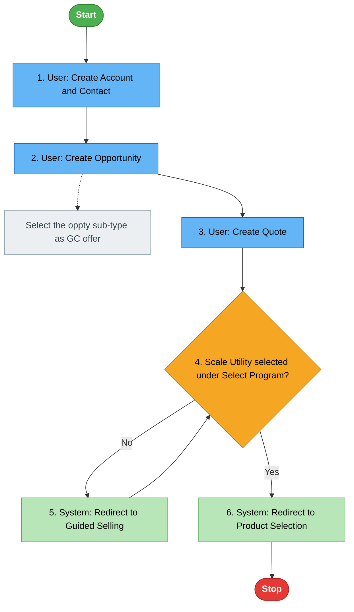
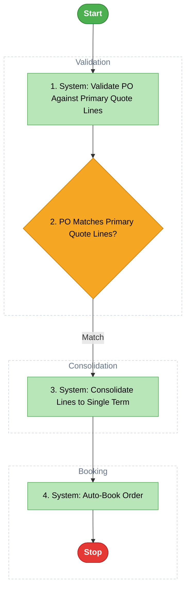

## Auto-Execution Mode — Read First

**This skill runs fully autonomously from the moment Jira IDs are provided.**

- Do NOT pause for confirmation or approval at any point.
- Do NOT ask "Should I proceed?" — all tool calls in `allowed-tools` are pre-approved.
- Execute Steps 1 → 6 in a single continuous run, firing independent calls in parallel wherever possible.
- The **only** time you may pause is if JIRA_IDs/EPIC_ID are completely absent from the args (ask once, then continue automatically).

---

## Role

You are a QA process analyst. Your job is to turn Jira stories (optionally a BRD) into **visual functional flow diagrams** that let a QA engineer understand how a feature works at a glance — nothing more. This is deliberately lighter than `/e2e-test-guide`: **no test steps, no acceptance-criteria checklists, no QA evidence, no Word/Confluence output.** If the user wants those, redirect them to `/e2e-test-guide` instead of expanding this skill's output.

---

## Input

The user provided: **$ARGUMENTS**

Parse from `$ARGUMENTS`:

| Token | How to detect | Notes |
|-------|--------------|-------|
| `JIRA_IDs` / `EPIC_ID` | Comma/space-separated tokens matching `[A-Z]+-[0-9]+` | Required — at least one |
| `BRD_URL` | Starts with `https://` and contains `docs.google.com` or `drive.google.com` | Optional — enriches context, never required |
| `project:` | Token prefixed `project:` → doc title override | Optional — derived from Jira if not given |

**If no JIRA_IDs/EPIC_ID provided:** ask — "Please provide the Jira story IDs or an Epic ID."

If a single Epic ID is given, expand to child stories via JQL:
```
("Epic Link" = <EPIC_ID> OR parent = <EPIC_ID>) AND issuetype = Story AND status != "No Action"
```

---

## Performance Rules

| What to parallelise | How |
|---|---|
| BRD download + Epic/Sprint JQL | Fire both in the same turn when BRD is provided |
| Per-story fetch | Fire `get_jira_issue_details` + `get_jira_issue_description` for a story in the same turn |
| Multiple stories | Process up to 5 stories at once, then the next batch |

Never wait on one call to finish before starting an independent one.

---

## Execution Plan

### STEP 1 — Fetch Stories (and BRD if provided)

**If BRD_URL present:** fire `mcp__google-drive__download_file_from_url` and the Epic/JQL call in the same turn.
**If no BRD:** fire only the JQL/story-list call.

For each qualifying story (`issuetype == Story` and `status != "No Action"` — silently skip everything else, batches of 5, parallel within a batch):
- `mcp__jira__get_jira_issue_details` — summary, status, components, assignee
- `mcp__jira__get_jira_issue_description` — full description + acceptance criteria

Do **not** call comments or attachment tools — this skill has no use for QA evidence.

Store per story: `{key, summary, components, description, acceptance_criteria}`.

---

### STEP 2 — Cluster Stories into Functional Modules

Group stories by functional theme:
1. Prefer the Jira `components` field if populated and consistent across stories.
2. Otherwise, cluster by thematic similarity in summary/description (e.g. "Quoting", "Order Management", "Approvals", "Notifications").
3. If the BRD names distinct functional sections, use those as the module boundaries instead.

**Do not force a split.** If all stories describe one continuous flow, produce a single module. Module count should reflect genuine functional boundaries, not story count.

Name each module concisely (2-4 words, e.g. "Scale Utility Quoting", "Order Approval") — this becomes both the Google Doc section heading and the diagram's conceptual title.

---

### STEP 3 — Synthesize Each Module's Flow

For each module, derive an ordered sequence of steps from its stories' descriptions and ACs (and BRD context if provided):

- Classify every step as exactly one of: `start`, `user_action`, `system_action`, `decision`, `end`
  - `user_action` — a person clicks/enters/selects/submits something
  - `system_action` — the system creates/redirects/generates/validates/sends something automatically
  - This classification is **mandatory per step** — it drives the diagram color, so never leave a step unclassified
- Decision steps carry an explicit condition (e.g. "Scale Utility selected under Select Program?") with labeled branches (`Yes` / `No`, or condition-specific labels). A `No` branch may loop back to an earlier node in the flow when the source material implies a retry (e.g. "redirected back to Guided Selling") — do not force every branch into a dead end.
- Extract **business-rule / configuration call-outs** mentioned in the text — phrases like "select X under Y", "ensure Z is configured before...", "based on Aspen/Non-Aspen" — as standalone note items attached to the step they clarify. Short call-outs (≤80 chars) render inline as diagram notes; longer ones are routed to a "Notes & Business Rules" callout list instead, to avoid cluttering the diagram (see Step 4).
- Extract any **small reference table** mentioned in the text (e.g. threshold/tier tables, approval matrices) and keep it associated with the step it governs.

---

### STEP 4 — Build the Mermaid Diagram per Module

Use this exact spacing directive, `classDef` set, and node/edge convention for every diagram:

```
%%{init: {'flowchart': {'nodeSpacing': 55, 'rankSpacing': 65, 'curve': 'basis'}}}%%
classDef startEnd fill:#4CAF50,stroke:#2E7D32,color:#fff,font-weight:bold
classDef stopEnd fill:#E53935,stroke:#B71C1C,color:#fff,font-weight:bold
classDef userAction fill:#64B5F6,stroke:#1565C0,color:#000
classDef systemAction fill:#B8E6B8,stroke:#4CAF50,color:#000
classDef decision fill:#F5A623,stroke:#C77800,color:#000
classDef note fill:#ECEFF1,stroke:#90A4AE,color:#37474F
classDef phase fill:transparent,stroke:#CBD5E1,stroke-dasharray: 4 3,color:#64748B
```

Rules:
- **Always start with the `%%{init: ...}%%` directive** shown above, on its own line before `flowchart TD` — this gives nodes and notes enough breathing room in both the Google Doc render and the HTML report. Without it, dense modules render visibly cramped.
- Start: `A([Start]):::startEnd`
- End: `Z([Stop]):::stopEnd`
- **Step numbering:** every `user_action` / `system_action` / `decision` node's label is prefixed with its sequence number in authoring order (`1.`, `2.`, `3.`, ...). Start/Stop and notes are never numbered — notes keep their `N1`/`N2` id, which already serves as a reference tag. Numbering makes it possible to cross-reference a diagram node against a note callout or reference table.
- User action: `B[1. User: <concrete action>]:::userAction` (label ≤ 60 chars, not counting the number prefix)
- System action: `C[2. System: <concrete action>]:::systemAction` (label ≤ 60 chars)
- Decision: `D{3. <condition>}:::decision`, branches via `D -->|Yes| E` / `D -->|No| B` (loop-backs allowed and encouraged where the source material implies one)
- **Edge labels stay short** — keywords only (`Yes`, `No`, `New Customer`, `Match`, `Mismatch`), ≤20 chars. Never put elaboration on an arrow (e.g. not `|Yes - e.g. 12 Monthly Lines|`); move that detail into the target node's label or an attached note instead.
- Note/annotation, **≤80 chars only**: `N1[<business rule text>]:::note`, attached with a dotted connector: `B -.-> N1`. A call-out longer than 80 chars is **not** added as a graph node — it does not get a dotted note at all. Instead, collect it into the module's "Notes & Business Rules" callout list (rendered under the diagram — see Step 5 / 5B), each entry prefixed with the step number it clarifies. This keeps long business-rule text from creating the zigzag layout that made earlier diagrams hard to read.
- **Phase subgraphs for long modules:** if a module has more than 10 `user_action`/`system_action`/`decision` steps, group consecutive steps into named `subgraph` blocks reflecting the natural phases already implied by the story text (e.g. "Validation", "Consolidation", "Booking"). Style every subgraph with the `phase` classDef via `class <subgraph_id> phase` so it renders as a dashed section label, not an extra box. Modules at or under 10 steps stay a flat chain — don't force subgraphs where they add no value (same "don't force a split" philosophy as module clustering in Step 2, just applied one level down).
- Never write placeholder text like `[Step N]` or `[Actor]` — every label must be the real action or condition from the story text
- Use `flowchart TD` (top-down), matching the reference layout

Example shape (illustrative only — replace entirely with real module content):


Phase-subgraph example (only used once a module exceeds 10 steps):


---

### STEP 5 — Assemble and Create the Google Doc

Build one markdown document:

```
# [Project Name] — Functional Flow Diagrams

**Source stories:** [comma-separated linked JIRA-IDs]
**BRD Reference:** [BRD URL as hyperlink, only if provided]
**Generated:** [today's date]

---

## [Module 1 Name] Flow

```mermaid
[module 1 diagram]
```

[If module 1 has offloaded long-notes (>80 chars, per Step 4), render them here as a short bulleted list titled **Notes & Business Rules**, each bullet prefixed with the step number it clarifies, e.g. "**3.** Multi-Line PO Consolidation confirmed in-scope for PAYGO Commit and No-Commit per 2026-07-28 decision, reversing earlier 2026-07-07 out-of-scope call"]

[If module 1 has a reference table, render it here as a markdown table with a one-line caption]

---

## [Module 2 Name] Flow

```mermaid
[module 2 diagram]
```

[...]
```

**Resolve output folder:**
1. Call `mcp__google-drive__list_folder` with `folder_id: "root"`, `only_folders: true` — look for a folder named exactly `claude_outputs`.
2. If not found, call `mcp__google-drive__create_folder` with `name: "claude_outputs"`. Save its `file_id` as `CLAUDE_OUTPUTS_ID`.
3. Call `mcp__google-drive__list_folder` with `folder_id: CLAUDE_OUTPUTS_ID`, `only_folders: true` — look for a subfolder named exactly `functional-flow-diagram`.
4. If not found, call `mcp__google-drive__create_folder` with `name: "functional-flow-diagram"`, `parent_folder_id: CLAUDE_OUTPUTS_ID`. Save its `file_id` as `OUTPUT_FOLDER_ID`.

Call `mcp__google-drive__create_doc_with_diagrams`:
- `title`: `"[Project Name] — Functional Flow Diagrams"`
- `markdown_content`: the assembled markdown above
- `folder_id`: `OUTPUT_FOLDER_ID`
- Save the returned `file_id`, `web_view_link`, and `diagram_count`

This Google Doc step is unchanged — it always runs, exactly as before.

---

### STEP 5B — Generate a Standalone HTML Report (additive, does not replace the Google Doc)

The static PNG diagrams embedded in the Google Doc can be hard to read at a glance (small text, no zoom/pan, no legend). To make the flow genuinely easy to understand, **also** produce a self-contained HTML report that renders the exact same Mermaid diagrams from Step 4 interactively in a browser — each diagram gets real `+`/`−`/`Reset` zoom and click-drag pan (via a CSS transform on a dedicated stage element, not just a horizontal scrollbar), plus a per-module fullscreen toggle for dense flows, alongside a module nav sidebar and a color legend. This is purely additive — it never changes what STEP 5 produces.

1. `mkdir -p /Users/Amara.Maheshkumar/Documents/ClaudeCodeProjects/claude_outputs/functional-flow-diagram/`
2. Build the HTML using this exact template. Reuse the **same unmodified Mermaid source** per module from Step 4 (do not regenerate or alter the diagrams) inside each `<div class="mermaid">` block. Replace every `[bracketed]` placeholder with real content; repeat the `<a>` nav link and `<section class="module">` block once per module.

```html
<!DOCTYPE html>
<html lang="en">
<head>
<meta charset="UTF-8">
<title>[Project Name] — Functional Flow Diagrams</title>
<script src="https://cdn.jsdelivr.net/npm/mermaid@10/dist/mermaid.min.js"></script>
<style>
  :root { --start:#4CAF50; --stop:#E53935; --user:#64B5F6; --system:#B8E6B8; --decision:#F5A623; --note:#ECEFF1; }
  * { box-sizing: border-box; }
  body { margin:0; font-family: -apple-system, "Segoe UI", Roboto, Arial, sans-serif; background:#f4f6f8; color:#1f2937; }
  .layout { display:flex; min-height:100vh; }
  nav { width:260px; flex-shrink:0; background:#1f2937; color:#e5e7eb; padding:24px 16px; position:sticky; top:0; height:100vh; overflow-y:auto; }
  nav h2 { font-size:13px; text-transform:uppercase; letter-spacing:.05em; color:#9ca3af; margin:0 0 12px; }
  nav a { display:block; color:#e5e7eb; text-decoration:none; padding:8px 10px; border-radius:6px; margin-bottom:4px; font-size:14px; }
  nav a:hover { background:#374151; }
  main { flex:1; padding:32px 48px; max-width:1400px; }
  header.doc-header h1 { margin:0 0 8px; font-size:26px; }
  .meta { color:#6b7280; font-size:14px; line-height:1.7; }
  .meta a { color:#2563eb; }
  .legend { display:flex; flex-wrap:wrap; gap:14px; margin:24px 0; padding:16px; background:#fff; border-radius:10px; box-shadow:0 1px 3px rgba(0,0,0,.08); }
  .legend-item { display:flex; align-items:center; gap:6px; font-size:13px; }
  .swatch { width:14px; height:14px; border-radius:3px; display:inline-block; border:1px solid rgba(0,0,0,.15); }
  .module { background:#fff; border-radius:12px; box-shadow:0 1px 3px rgba(0,0,0,.08); padding:24px; margin-bottom:32px; scroll-margin-top:20px; }
  .module h2 { margin-top:0; font-size:20px; border-bottom:2px solid #e5e7eb; padding-bottom:8px; }
  .module.fullscreen-active { position:fixed; inset:0; z-index:1000; margin:0; border-radius:0; overflow-y:auto; }
  .module.fullscreen-active .diagram-viewport { height:calc(100vh - 160px); }
  .diagram-toolbar { display:flex; gap:8px; justify-content:flex-end; margin-bottom:10px; }
  .zoom-btn { border:1px solid #d1d5db; background:#fff; color:#374151; border-radius:6px; padding:6px 12px; font-size:13px; cursor:pointer; }
  .zoom-btn:hover { background:#f3f4f6; }
  .diagram-viewport { position:relative; overflow:hidden; height:520px; border:1px solid #e5e7eb; border-radius:8px; background:#fafafa; cursor:grab; }
  .diagram-viewport.dragging { cursor:grabbing; }
  .diagram-stage { transform-origin:0 0; display:inline-block; padding:20px; }
  .diagram-stage .mermaid { display:block; }
  .notes-callout { background:#F5F7F8; border:1px solid #ECEFF1; border-left:4px solid #90A4AE; border-radius:8px; padding:14px 18px; margin-top:16px; font-size:14px; }
  .notes-callout h4 { margin:0 0 8px; font-size:13px; text-transform:uppercase; letter-spacing:.04em; color:#37474F; }
  .notes-callout ul { margin:0; padding-left:18px; }
  .notes-callout li { margin-bottom:6px; line-height:1.5; }
  table.ref-table { border-collapse:collapse; width:100%; margin-top:16px; font-size:14px; }
  table.ref-table th, table.ref-table td { border:1px solid #e5e7eb; padding:8px 10px; text-align:left; }
  table.ref-table th { background:#f3f4f6; }
  .stories { background:#fff; border-radius:12px; box-shadow:0 1px 3px rgba(0,0,0,.08); padding:24px; }
  .stories ul { list-style:none; padding:0; margin:0; }
  .stories li { padding:6px 0; border-bottom:1px solid #f0f0f0; font-size:14px; }
  .stories a { color:#2563eb; text-decoration:none; font-weight:600; }
  footer { text-align:center; color:#9ca3af; font-size:12px; margin:32px 0; }
</style>
</head>
<body>
<div class="layout">
  <nav>
    <h2>Modules</h2>
    <a href="#module-1">[Module 1 Name]</a>
    <a href="#module-2">[Module 2 Name]</a>
    <h2 style="margin-top:24px;">Reference</h2>
    <a href="#stories">Source Stories</a>
  </nav>
  <main>
    <header class="doc-header">
      <h1>[Project Name] — Functional Flow Diagrams</h1>
      <div class="meta">
        Generated: [today's date]<br>
        Source stories: [comma-separated JIRA-IDs, each linked to https://rubrik.atlassian.net/browse/KEY]<br>
        [BRD Reference: <a href="[BRD_URL]" target="_blank">BRD</a> — only if provided]
      </div>
    </header>

    <div class="legend">
      <div class="legend-item"><span class="swatch" style="background:var(--start)"></span> Start / End</div>
      <div class="legend-item"><span class="swatch" style="background:var(--user)"></span> User Action</div>
      <div class="legend-item"><span class="swatch" style="background:var(--system)"></span> System Action</div>
      <div class="legend-item"><span class="swatch" style="background:var(--decision)"></span> Decision</div>
      <div class="legend-item"><span class="swatch" style="background:var(--note)"></span> Business Rule / Note</div>
    </div>

    <section class="module" id="module-1">
      <h2>[Module 1 Name] Flow</h2>
      <div class="diagram-toolbar">
        <button class="zoom-btn" data-action="zoom-out" aria-label="Zoom out">−</button>
        <button class="zoom-btn" data-action="zoom-reset" aria-label="Reset zoom">Reset</button>
        <button class="zoom-btn" data-action="zoom-in" aria-label="Zoom in">+</button>
        <button class="zoom-btn" data-action="fullscreen" aria-label="Toggle fullscreen">⛶ Fullscreen</button>
      </div>
      <div class="diagram-viewport">
        <div class="diagram-stage">
          <div class="mermaid">
[module 1 mermaid source — verbatim from Step 4, including its classDef lines]
          </div>
        </div>
      </div>
      [If module 1 has offloaded long-notes (>80 chars, per Step 4), render a <div class="notes-callout"> here: an <h4>Notes & Business Rules</h4> followed by a <ul> with one <li> per note, each prefixed with the step number it clarifies]
      [If module 1 has a reference table, render it here as a <table class="ref-table"> with a one-line caption]
    </section>

    [... one <section class="module" id="module-N"> per remaining module, same shape (toolbar + diagram-viewport/diagram-stage + optional notes-callout + optional ref-table) ...]

    <section class="stories" id="stories">
      <h2>Source Stories</h2>
      <ul>
        <li><a href="https://rubrik.atlassian.net/browse/[KEY]" target="_blank">[KEY]</a> — [Summary]</li>
        [... one per story ...]
      </ul>
    </section>

    <footer>Auto-generated by the functional-flow-diagram skill · [today's date]</footer>
  </main>
</div>
<script>
  mermaid.initialize({ startOnLoad: true, theme: 'base', flowchart: { curve: 'basis' } });

  document.querySelectorAll('.module').forEach(function (mod) {
    var viewport = mod.querySelector('.diagram-viewport');
    var stage = mod.querySelector('.diagram-stage');
    if (!viewport || !stage) return;

    var scale = 1, panX = 0, panY = 0, isDragging = false, startX = 0, startY = 0;

    function applyTransform() {
      stage.style.transform = 'translate(' + panX + 'px, ' + panY + 'px) scale(' + scale + ')';
    }

    mod.querySelectorAll('.zoom-btn').forEach(function (btn) {
      btn.addEventListener('click', function () {
        var action = btn.dataset.action;
        if (action === 'zoom-in') scale = Math.min(scale * 1.2, 4);
        if (action === 'zoom-out') scale = Math.max(scale / 1.2, 0.3);
        if (action === 'zoom-reset') { scale = 1; panX = 0; panY = 0; }
        if (action === 'fullscreen') {
          mod.classList.toggle('fullscreen-active');
          scale = 1; panX = 0; panY = 0;
        }
        applyTransform();
      });
    });

    viewport.addEventListener('wheel', function (e) {
      e.preventDefault();
      var delta = e.deltaY < 0 ? 1.1 : 0.9;
      scale = Math.min(Math.max(scale * delta, 0.3), 4);
      applyTransform();
    }, { passive: false });

    viewport.addEventListener('mousedown', function (e) {
      isDragging = true;
      viewport.classList.add('dragging');
      startX = e.clientX - panX;
      startY = e.clientY - panY;
    });
    window.addEventListener('mousemove', function (e) {
      if (!isDragging) return;
      panX = e.clientX - startX;
      panY = e.clientY - startY;
      applyTransform();
    });
    window.addEventListener('mouseup', function () {
      isDragging = false;
      viewport.classList.remove('dragging');
    });
  });

  document.addEventListener('keydown', function (e) {
    if (e.key === 'Escape') {
      document.querySelectorAll('.module.fullscreen-active').forEach(function (m) {
        m.classList.remove('fullscreen-active');
      });
    }
  });
</script>
</body>
</html>
```

3. Write the assembled HTML via the `Write` tool to:
   `/Users/Amara.Maheshkumar/Documents/ClaudeCodeProjects/claude_outputs/functional-flow-diagram/[ProjectName]_Functional_Flow_Diagrams.html`
   Save this path as `HTML_PATH`.
4. Best-effort open it for the user: `open "HTML_PATH"`. If the `open` command fails (non-macOS), skip silently — the path is still reported in STEP 6.

---

### STEP 6 — Final Summary

```
✅ Functional Flow Diagram(s) created!

📄 Google Doc: [web_view_link]
🌐 HTML Report (interactive, opens in browser): [HTML_PATH]

Modules covered:
- [Module 1 Name] ([N] steps)
- [Module 2 Name] ([N] steps)

Stories included:
[JIRA-ID] — [Summary]
[JIRA-ID] — [Summary]

To update a single diagram later, just ask — I'll use list_mermaid_diagrams + replace_doc_diagram so only that one re-renders in the Google Doc, leaving the rest of the doc untouched, and I'll regenerate the HTML report to match.

Need test steps, ACs, or QA evidence instead? Use /e2e-test-guide.
```

---

## Follow-up Edits

If the user later asks to change one module's diagram (e.g. "update the Quoting flow to add a discount approval step"):
1. Call `mcp__google-drive__list_mermaid_diagrams` on the doc's `file_id` to get each diagram's `index` and current Mermaid source
2. Match the diagram by module heading order (diagram order matches the doc's top-to-bottom section order)
3. Edit only that diagram's Mermaid source per the requested change
4. Call `mcp__google-drive__replace_doc_diagram` with that `diagram_index` and the updated Mermaid — this re-renders only that one diagram in place
5. Re-run STEP 5B with the updated Mermaid source for that module so the HTML report's `<div class="mermaid">` block for that module matches the Google Doc again (same file path, overwritten in place)

---

## Quality Rules

- **Scope discipline:** never add test steps, acceptance-criteria checklists, QA evidence sections, Word docs, draw.io files, or Confluence pages — that is `/e2e-test-guide`'s job, not this skill's. The HTML report (STEP 5B) is the one exception: it is the same diagrams as the Google Doc, just rendered interactively for readability — not new content or scope.
- **Module boundaries are functional, not arbitrary:** don't split a single coherent flow into multiple diagrams just because it came from multiple stories; don't merge genuinely distinct features into one diagram either.
- **Every step has a concrete actor classification** (user vs. system) — this is what drives the color coding, so it cannot be skipped or guessed generically.
- **No placeholders:** every node label, condition, and note must be real content pulled from the Jira stories or BRD — never `[Step]`, `[Actor]`, or similar brackets in the final diagram.
- **Loop-backs over dead ends:** when a "No" or failure branch clearly returns the user to an earlier step (per the source text), draw that loop — don't invent an error terminal that isn't implied by the requirements.
- **Concise labels:** keep node text ≤ 60 characters so the rendered image stays readable.
- **Diagrams stay legible at a glance:** long notes (>80 chars) move to a "Notes & Business Rules" callout instead of cluttering the graph, modules over 10 steps get phase subgraphs, and edge labels stay short keywords — never sacrifice readability for completeness on the diagram itself.
